# Pesquisa A STDMSP — análise por raça

**Fonte:** *Condições de Trabalho para as Trabalhadoras Domésticas (Responses).xlsx* — STDMSP, campo 2024 (n=242, auto-administrada via Google Forms).

**Recortes:**

- **Afro-descendentes** (pardas + pretas): n=140
- **Brancas**: n=93
- **Total race-known**: n=233 (exclui 2 Amarela/Indígena + 7 sem resposta de raça)

**Critério de discrepância:** diferença afro – brancas ≥ 10 pontos percentuais (em negrito na coluna Δ das tabelas).

**Referências 2024 para o item 4 (salário):** R$ 1.412,00 = salário mínimo federal · **R$ 1.540,59 = piso CC doméstica SP 2024 (Faixa 1)** · R$ 1.476,75 = limite usado nas faixas da pesquisa (piso CC 2023, defasado) — a pesquisa **subestima** o descumprimento porque trabalhadoras entre R$ 1.476,75 e R$ 1.540,59 estão abaixo do piso vigente mas aparecem na faixa superior.

---

## Q01 — Idade

*Distribuição por faixa etária*

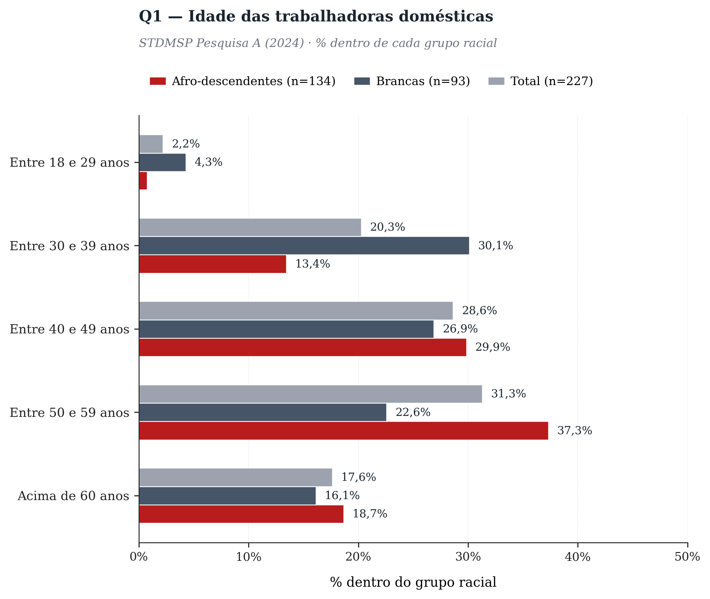

| Categoria | Afro | Brancas | Total | Δ (pp) |
|---|---:|---:|---:|---:|
| Entre 18 e 29 anos | 0,7% (1) | 4,3% (4) | 2,2% (5) | -3,6 |
| Entre 30 e 39 anos | 13,4% (18) | 30,1% (28) | 20,3% (46) | **-16,7** |
| Entre 40 e 49 anos | 29,9% (40) | 26,9% (25) | 28,6% (65) | +3,0 |
| Entre 50 e 59 anos | 37,3% (50) | 22,6% (21) | 31,3% (71) | **+14,7** |
| Acima de 60 anos | 18,7% (25) | 16,1% (15) | 17,6% (40) | +2,5 |

A categoria é envelhecida em ambos os grupos raciais — ~70% têm 40 anos ou mais. **Mas a distribuição etária é racialmente assimétrica:** **brancas concentram-se em 30-39 anos** (30,1% vs 13,4% afro, gap -16,7pp), enquanto **afro concentram-se em 50-59 anos** (37,3% vs 22,6% brancas, gap +14,7pp). Quase 56% das afro têm 50+ anos vs ~39% das brancas. Interpretação possível: trajetórias raciais diferentes na categoria — afro permanecem (ou se reinserem) mais tempo no trabalho doméstico; brancas entram e saem em fases mais jovens.

---

## Q02 — Composição racial

*Pardas + Pretas = afro-descendentes (n=140)*

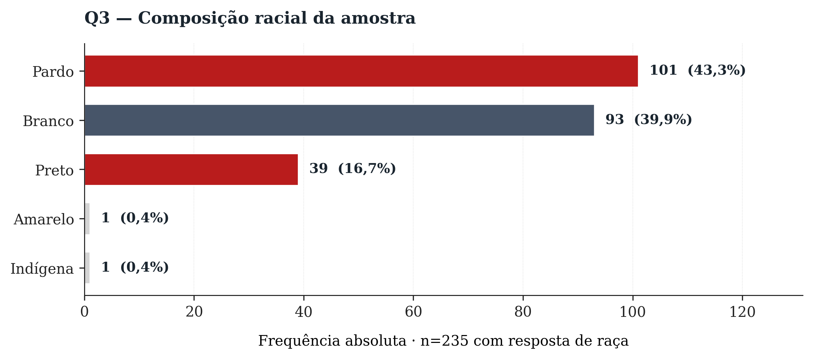

| Categoria | Afro | Brancas | Total | Δ (pp) |
|---|---:|---:|---:|---:|
| Pardo | — (101) | — (0) | 43,3% (101) | — |
| Branco | — (0) | — (93) | 39,9% (93) | — |
| Preto | — (39) | — (0) | 16,7% (39) | — |
| Amarelo | — (0) | — (0) | 0,4% (1) | — |
| Indígena | — (0) | — (0) | 0,4% (1) | — |

Da amostra com resposta de raça (n=235), **140 são afro-descendentes** (pardas + pretas) e **93 são brancas**. A composição da amostra A (60% afro) é semelhante à composição racial da categoria doméstica em São Paulo observada na PNADC (~56-60% pretas + pardas em 2024-2026).

---

## Q03 — Diarista vs vínculo

*% da amostra em cada modalidade*

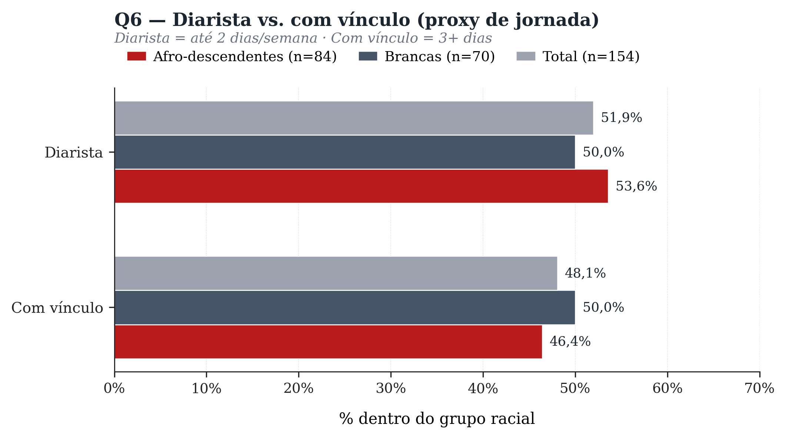

| Categoria | Afro | Brancas | Total | Δ (pp) |
|---|---:|---:|---:|---:|
| Diarista | 53,6% (45) | 50,0% (35) | 51,9% (80) | +3,6 |
| Com vínculo | 46,4% (39) | 50,0% (35) | 48,1% (74) | -3,6 |

Aproximadamente metade da amostra trabalha como diarista, metade com vínculo. **Diarismo = jornada parcial** legal (LC 150/2015 art. 1º §1º) e implica exclusão da maioria dos direitos previdenciários automáticos.

---

## Q04 — Salário base

*R$ por mês · faixas*

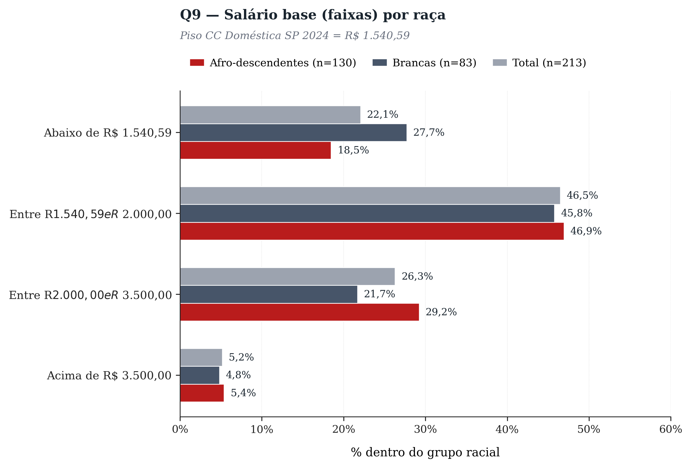

| Categoria | Afro | Brancas | Total | Δ (pp) |
|---|---:|---:|---:|---:|
| Abaixo de R$ 1.540,59 | 18,5% (24) | 27,7% (23) | 22,1% (47) | -9,2 |
| Entre R$ 1.540,59 e R$ 2.000,00 | 46,9% (61) | 45,8% (38) | 46,5% (99) | +1,1 |
| Entre R$ 2.000,00 e R$ 3.500,00 | 29,2% (38) | 21,7% (18) | 26,3% (56) | +7,5 |
| Acima de R$ 3.500,00 | 5,4% (7) | 4,8% (4) | 5,2% (11) | +0,6 |

**Referências 2024 (quando a pesquisa foi aplicada):**

- Salário mínimo federal: **R$ 1.412,00**
- **Piso da Convenção Coletiva doméstica SP (Faixa 1): R$ 1.540,59** ← valor REAL em 2024
- Limite usado nas faixas do formulário: R$ 1.476,75 (piso CC 2023, **defasado**)

**⚠ Nota metodológica crítica:** o formulário da pesquisa foi feito com a faixa "Abaixo de R$ 1.476,75" porque tomou o piso CC 2023 como referência, mas as respostas chegaram em 2024 quando o piso já era R$ 1.540,59. Isto significa que **a pesquisa SUBESTIMA o descumprimento**: trabalhadoras que recebiam entre R$ 1.476,75 e R$ 1.540,59 estão **abaixo do piso CC vigente** mas aparecem na faixa "Entre R$ 1.476,75 e R$ 2.000,00". O número real de descumprimento é maior que os 22,1% reportados.

**Achado bruto contra-intuitivo** (precisa ser destrinchado): 18,5% das afro vs 27,7% das brancas recebem **abaixo de R$ 1.476,75** (que é abaixo até do piso defasado — descumprimento inquestionável). Esse padrão é oposto ao observado no PNADC nacional (negras ganham menos). Mas estratificar por **tipo de contrato (Q6)** muda completamente a leitura:

**Descumprimento (abaixo de R$ 1.476,75) por tipo de contrato:**

- **Diaristas (n=76)**: 42% abaixo — descumprimento massivo.
  - Afro diaristas: 36,4% (16/44)
  - Brancas diaristas: 51,6% (16/31)
- **Com-vínculo (n=72)**: 17% abaixo — situação significativamente melhor.
  - Afro com-vínculo: 13,9% (5/36)
  - Brancas com-vínculo: 21,2% (7/33)

**O verdadeiro eixo do descumprimento é diarismo × com-vínculo, não raça.** Diaristas são 2,5× mais vulneráveis ao descumprimento que trabalhadoras com vínculo. A 'inversão' racial agregada reflete dois problemas:

1. **Não-significância estatística**: ICs Wilson 95% para 'abaixo do piso' se sobrepõem entre afro [12,8%; 26,7%] e brancas [19,4%; 38,0%]. Teste z duas proporções: p ≈ 0,11 — o gap aparente de 9pp pode ser ruído amostral.
2. **Viés de auto-seleção** + **ambiguidade da pergunta para diaristas**: brancas que respondem à pesquisa STDMSP são subpopulação periférica; 'salário base' para diarista não é categoria legal clara (a CC define piso por dia, não mensal).

**Recomendação editorial:** apresentar primariamente como **'descumprimento concentrado em diaristas (42%) e generalizado dado o piso real de R$ 1.540,59'**, com gap racial subordinado à estrutura contratual e não estatisticamente robusto.

---

## Q04b — Salário × contrato × raça

*Decompondo o achado contra-intuitivo do Q04*

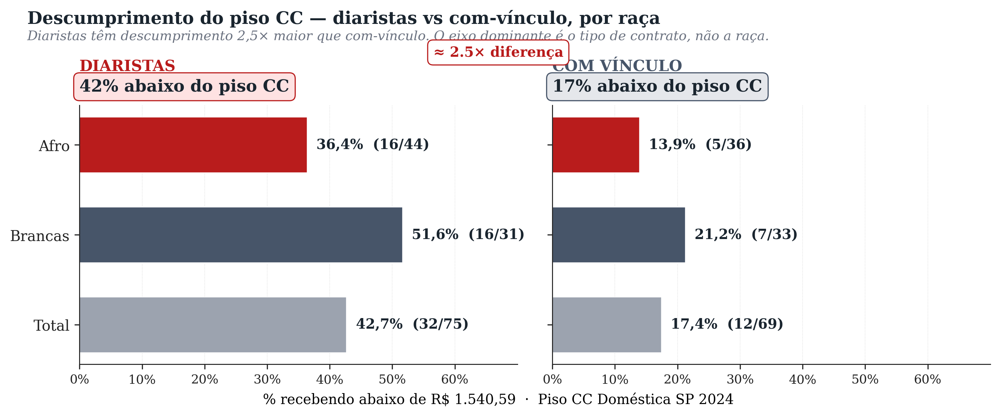

**O verdadeiro eixo do descumprimento é o tipo de contrato, não a raça.** Diaristas tem 42% abaixo do limite da pesquisa (R$ 1.476,75); com-vínculo têm 17%. Dentro de cada contrato, o gap racial é secundário (brancas levemente acima em ambos os grupos). Esse padrão estratificado contradiz a leitura ingênua do Q04 agregado.

**Caveat metodológico crítico (dupla camada):**

1. **Piso defasado no formulário**: o limite R$ 1.476,75 usado nas faixas reflete o piso CC de 2023. Em 2024, quando a pesquisa foi aplicada, o piso CC real era R$ 1.540,59. Trabalhadoras entre esses dois valores estão **abaixo do piso vigente** mas aparecem na faixa imediatamente superior. **O descumprimento real é maior que os 22% reportados** — possivelmente significativamente.
2. **CC negociado para trabalhadoras com vínculo**: para diaristas, a CC SP estabelece um piso por dia trabalhado, não um salário mensal. A pergunta 'salário base' é ambígua nessa categoria. Para diaristas, 'abaixo do piso' deve ser lido como **proxy de vulnerabilidade econômica**, não descumprimento legal estrito.

---

## Q05 — Valor da diária — distribuição individual

*Diaristas (n=73) · Piso CC SP 2024 = R$ 210*

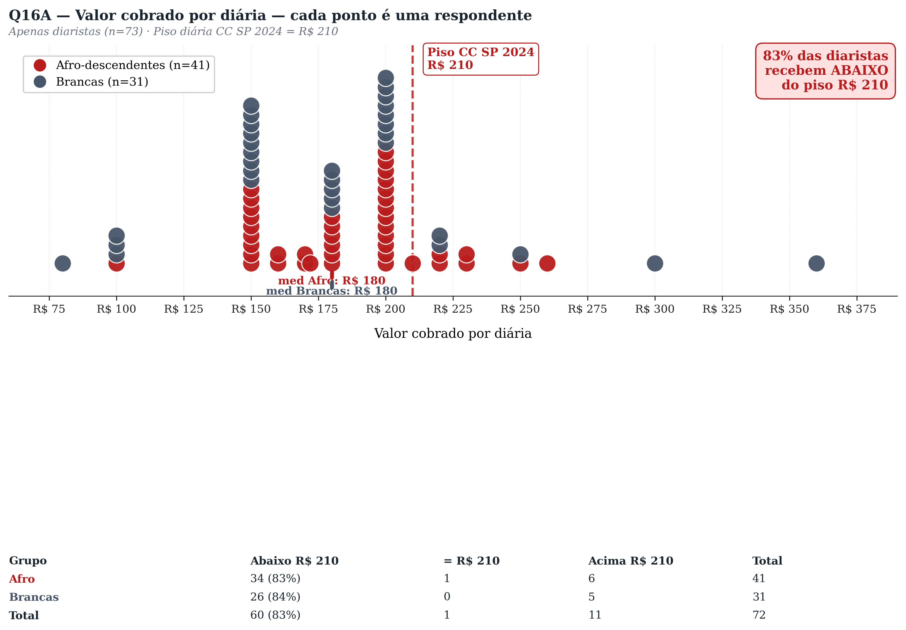

**Achado principal — descumprimento massivo do piso diária:** **83% das diaristas recebem abaixo do piso CC SP 2024 (R$ 210)**.

**Distribuição completa (R$ 80 a R$ 360):**

| Faixa | Afro | Brancas | Total |
|---|---:|---:|---:|
| Abaixo de R$ 210 | 34 (83%) | 26 (84%) | 60 (83%) |
| Igual a R$ 210 | 1 | 0 | 1 |
| Acima de R$ 210 | 6 | 5 | 11 |
| **Total** | **41** | **31** | **72** |

**Medianas:** afro R$ 180 · brancas R$ 180 · total R$ 180.

**Sem hiato racial significativo na mediana** — diferente do padrão PNADC BR-wide (hiato 84,3%/hora no diarismo). No entorno STDMSP a heterogeneidade é dentro de cada grupo, não entre grupos: valores de R$ 80 até R$ 360, com concentração em R$ 150-R$ 200. A diária mediana paulista (~R$ 180) é **15% abaixo do piso CC** — descumprimento generalizado, atravessando raça.

---

## Q06 — Horas extras

*Recebem ou não pagamento por hora extra*

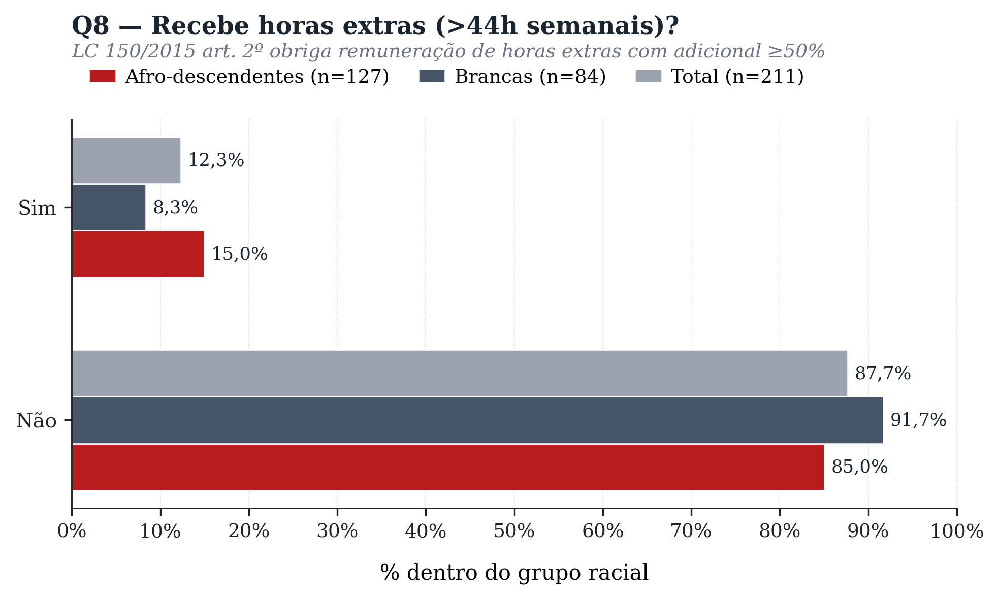

| Categoria | Afro | Brancas | Total | Δ (pp) |
|---|---:|---:|---:|---:|
| Sim | 15,0% (19) | 8,3% (7) | 12,3% (26) | +6,6 |
| Não | 85,0% (108) | 91,7% (77) | 87,7% (185) | -6,6 |

**85,0% das afro-descendentes e 91,7% das brancas **não recebem horas extras** — descumprimento generalizado da LC 150 em ambos os recortes raciais. 

---

## Q07 — Feriado 27/abr

*Proxy: como foi tratado no Dia da Trabalhadora Doméstica*

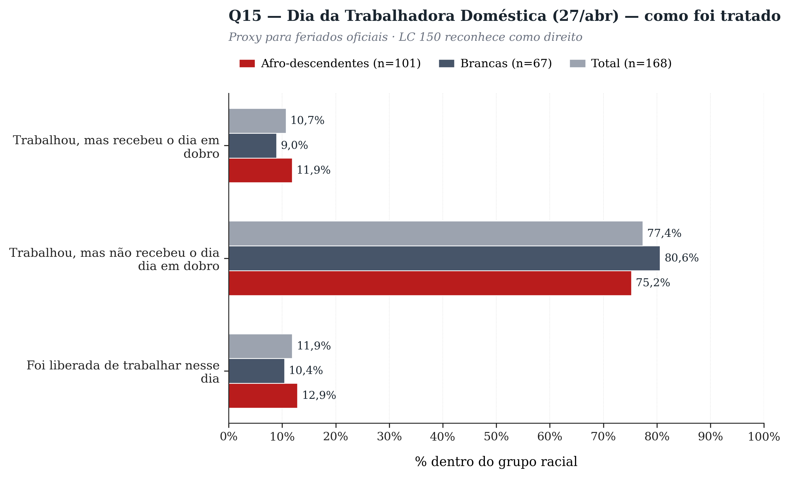

| Categoria | Afro | Brancas | Total | Δ (pp) |
|---|---:|---:|---:|---:|
| Trabalhou, mas recebeu o dia em dobro | 11,9% (12) | 9,0% (6) | 10,7% (18) | +2,9 |
| Trabalhou, mas não recebeu o dia dia em dobro | 75,2% (76) | 80,6% (54) | 77,4% (130) | -5,3 |
| Foi liberada de trabalhar nesse dia | 12,9% (13) | 10,4% (7) | 11,9% (20) | +2,4 |

Maioria absoluta trabalhou no 27/abr **sem receber dia em dobro** (afro 75,2%, brancas 80,6%). Apenas uma pequena minoria recebeu o dia em dobro como manda a lei (afro 11,9%, brancas 9,0%). 

---

## Q08 — Conhece CC?

*Conhecimento conceitual*

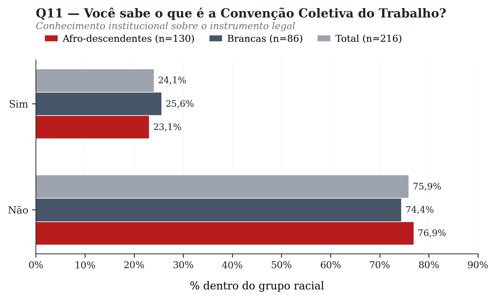

| Categoria | Afro | Brancas | Total | Δ (pp) |
|---|---:|---:|---:|---:|
| Sim | 23,1% (30) | 25,6% (22) | 24,1% (52) | -2,5 |
| Não | 76,9% (100) | 74,4% (64) | 75,9% (164) | +2,5 |

**Apenas 23,1% das afro-descendentes e 25,6% das brancas sabem o que é uma Convenção Coletiva.** Conhecimento institucional baixo em ambos os recortes — o sindicato tem trabalho de divulgação pela frente. 

---

## Q09 — Sabe da CC em SP?

*Conhecimento específico*

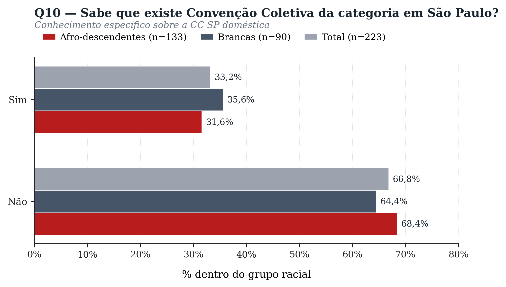

| Categoria | Afro | Brancas | Total | Δ (pp) |
|---|---:|---:|---:|---:|
| Sim | 31,6% (42) | 35,6% (32) | 33,2% (74) | -4,0 |
| Não | 68,4% (91) | 64,4% (58) | 66,8% (149) | +4,0 |

**31,6% das afro-descendentes e 35,6% das brancas** sabem da existência da CC paulista da categoria. A maioria absoluta — em ambos os grupos — não sabe. Esse desconhecimento direto da existência do instrumento que regula seus salários é o principal gargalo organizativo da STDMSP. 

---

## Q10 — CC trouxe benefício?

*Auto-avaliação*

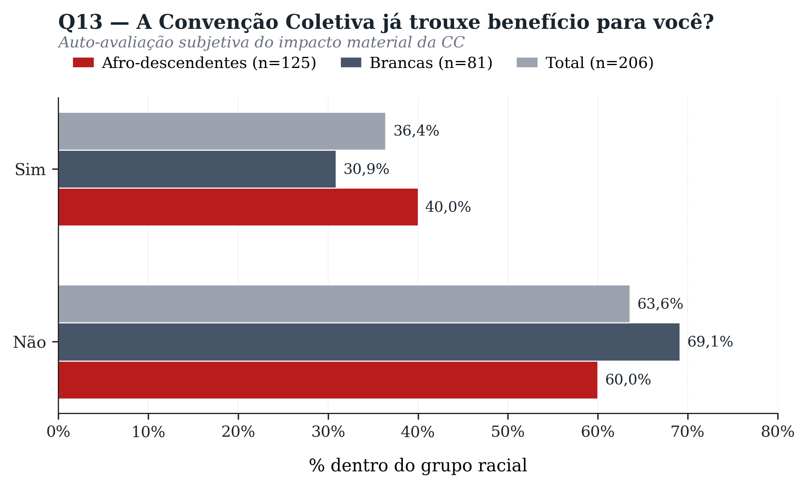

| Categoria | Afro | Brancas | Total | Δ (pp) |
|---|---:|---:|---:|---:|
| Sim | 40,0% (50) | 30,9% (25) | 36,4% (75) | +9,1 |
| Não | 60,0% (75) | 69,1% (56) | 63,6% (131) | -9,1 |

Entre quem respondeu, **40,0% das afro vs 30,9% das brancas** afirmaram ter recebido algum benefício direto da CC. O fato de a CC ter trazido benefício mesmo para quem não a conhece nominalmente (Q10/Q11) sugere que parte da categoria já se beneficia da CC sem identificar a origem. 

---

## Q11 — Sindicato ajuda?

*Confiança na estrutura sindical*

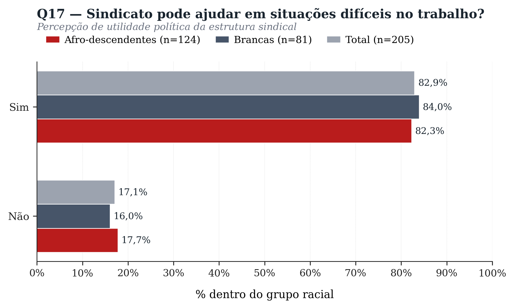

| Categoria | Afro | Brancas | Total | Δ (pp) |
|---|---:|---:|---:|---:|
| Sim | 82,3% (102) | 84,0% (68) | 82,9% (170) | -1,7 |
| Não | 17,7% (22) | 16,0% (13) | 17,1% (35) | +1,7 |

**82,3% das afro e 84,0% das brancas** acreditam que o sindicato pode ajudar em situações difíceis. Apesar do baixo conhecimento sobre CC (Q10/Q11), a confiança na ação sindical é alta — um achado político relevante para a STDMSP que pode fundamentar campanhas. 

---

## Q11b — Como o sindicato ajuda (texto livre)

*Categorização 5-buckets do Q17A (n=164)*

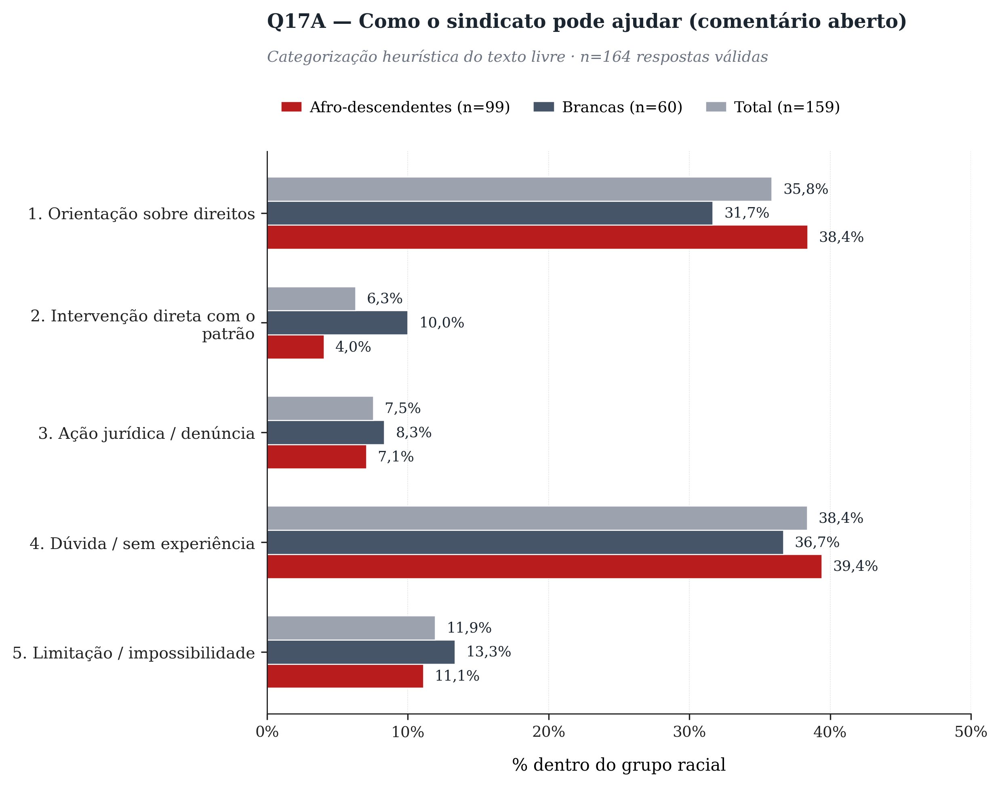

| Categoria | Afro | Brancas | Total | Δ (pp) |
|---|---:|---:|---:|---:|
| 1. Orientação sobre direitos | 38,4% (38) | 31,7% (19) | 35,8% (57) | +6,7 |
| 2. Intervenção direta com o patrão | 4,0% (4) | 10,0% (6) | 6,3% (10) | -6,0 |
| 3. Ação jurídica / denúncia | 7,1% (7) | 8,3% (5) | 7,5% (12) | -1,3 |
| 4. Dúvida / sem experiência | 39,4% (39) | 36,7% (22) | 38,4% (61) | +2,7 |
| 5. Limitação / impossibilidade | 11,1% (11) | 13,3% (8) | 11,9% (19) | -2,2 |

**Como a categoria entende o papel do sindicato em situações difíceis** (complemento qualitativo a Q11/Q17, que perguntou se o sindicato pode ajudar — 83% disseram sim).

**Achado dominante: o sindicato é entendido principalmente como instituição educacional/informacional** (35,8%, n=57). A maioria absoluta vê o papel sindical como **orientar, informar e explicar direitos** — não como mediador direto com o patrão nem como canal jurídico.

**Cerca de 38,4% (61 respondentes) admitem dúvida ou falta de experiência** — *'acho que sim, mas não sei como'*, *'nunca precisei'*, *'agora que descobri vou procurar'*. Esse percentual é consistente com o gargalo informacional já identificado em Q08/Q09 (apenas ~25% conhecem a CC).

**Apenas 11,9% (19) reconhecem barreiras estruturais** — *'o sindicato não pode entrar no meu trabalho'*, *'as patroas falam que o sindicato não manda nelas'*, *'se o patrão deixar, né'*. Pequena mas eloquente — articula o limite estrutural do trabalho doméstico em domicílio privado.

**Implicação editorial:** as respostas confirmam que **a categoria pensa o sindicato primariamente como espaço de aprendizado**, não como aparelho de luta institucional. Para a STDMSP, isso é simultaneamente boa notícia (confiança no papel educacional) e desafio (a função jurídica/de intervenção existe mas não está internalizada pela base).

---

## Q12 — Função do sindicato

*Texto livre categorizado em 5 buckets*

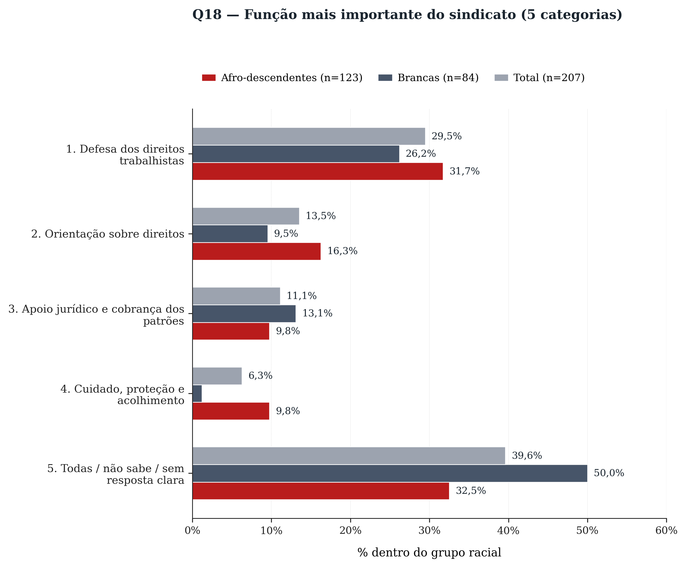

| Categoria | Afro | Brancas | Total | Δ (pp) |
|---|---:|---:|---:|---:|
| 1. Defesa dos direitos trabalhistas | 24,4% (30) | 16,7% (14) | 21,3% (44) | +7,7 |
| 2. Orientação sobre direitos | 15,4% (19) | 6,0% (5) | 11,6% (24) | +9,5 |
| 3. Apoio jurídico e cobrança dos patrões | 8,9% (11) | 15,5% (13) | 11,6% (24) | -6,5 |
| 4. Cuidado, proteção e acolhimento | 9,8% (12) | 4,8% (4) | 7,7% (16) | +5,0 |
| 5. Todas / não sabe / vago | 41,5% (51) | 57,1% (48) | 47,8% (99) | **-15,7** |

**Defesa de direitos** lidera em ambos os grupos (afro 24,4%, brancas 16,7%). Respostas residuais ('todas', 'não sei', vago) somam ~41,5% afro e ~57,1% brancas — refletem dificuldade de articular conceitualmente a função institucional. Diferença ≥10pp em **5. Todas / não sabe / vago**: afro 41,5% vs brancas 57,1% (-15.7pp).

---

## Q13 — Tempo de trabalho na categoria

*Anos trabalhando como doméstica · comparação por raça*

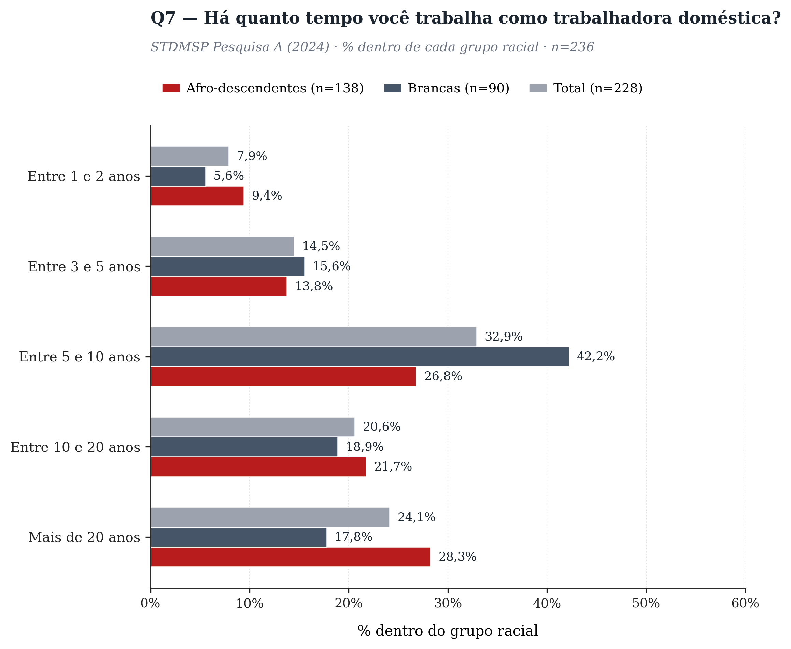

| Categoria | Afro | Brancas | Total | Δ (pp) |
|---|---:|---:|---:|---:|
| Entre 1 e 2 anos | 9,4% (13) | 5,6% (5) | 7,9% (18) | +3,9 |
| Entre 3 e 5 anos | 13,8% (19) | 15,6% (14) | 14,5% (33) | -1,8 |
| Entre 5 e 10 anos | 26,8% (37) | 42,2% (38) | 32,9% (75) | **-15,4** |
| Entre 10 e 20 anos | 21,7% (30) | 18,9% (17) | 20,6% (47) | +2,9 |
| Mais de 20 anos | 28,3% (39) | 17,8% (16) | 24,1% (55) | **+10,5** |

A categoria é de **carreira longa**: **44,7% da amostra tem mais de 10 anos** trabalhando como doméstica (50,0% afro vs 36,7% brancas). O bloco 'mais de 20 anos' sozinho concentra 28,3% das afro e 17,8% das brancas — combinado com o achado da Q1 (afro concentradas em 50-59 anos), sugere trajetória de permanência prolongada na categoria entre afro-descendentes. Trabalhadoras com menos de 2 anos são minoritárias (<10% em ambos os grupos), coerente com a queda geral do pool de novas entrantes documentada na PNADC. Diferença ≥10pp em **Entre 5 e 10 anos**: afro 26,8% vs brancas 42,2% (-15.4pp). Diferença ≥10pp em **Mais de 20 anos**: afro 28,3% vs brancas 17,8% (+10.5pp). 

---

## Q14 — Benefícios da CC × idade

*Q13=Sim ∩ Q14 detalhado (n=24) · cruzamento com Q1*

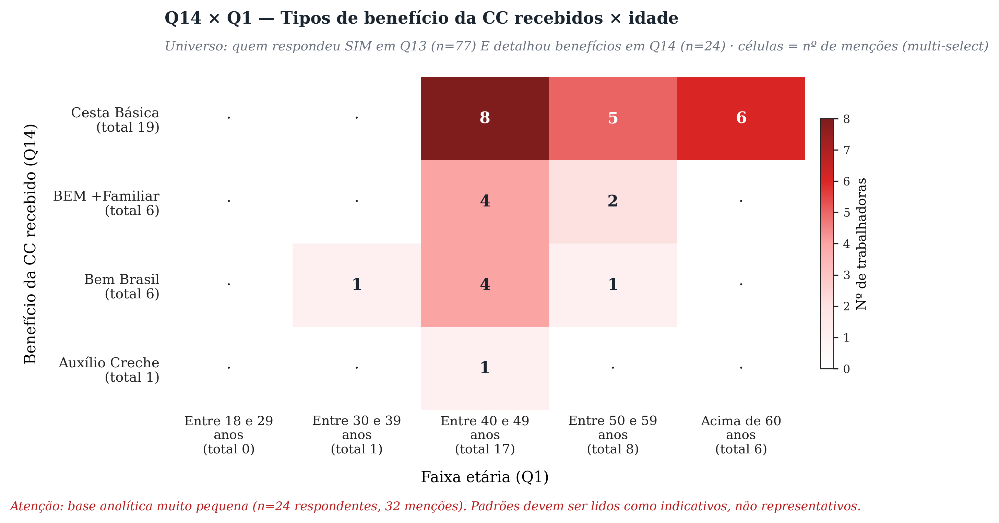

**Base analítica: n=24 respondentes** (de 77 que disseram SIM em Q13 sobre a CC ter trazido benefício, apenas 25 detalharam QUAIS benefícios recebem). O gap 77→25 é ele mesmo um achado: **~2/3 de quem reconhece impacto da CC não consegue nomear os benefícios concretos** — sugere que a CC opera como referência simbólica difusa, não como catálogo de vantagens navegáveis pela trabalhadora. 

Dentro desse recorte pequeno mas concentrado:

1. **Cesta Básica domina absolutamente**: 19 das 32 menções (59,4%). Único benefício da CC que chega a todas as faixas etárias 40+ na amostra. Interpretação: quando a CC 'aparece' materialmente na vida da doméstica, aparece como comida.
2. **BEM +Familiar e Bem Brasil** ficam num degrau abaixo (6 e 6 menções), concentrados em 40-49 e 50-59.
3. **Auxílio Creche = 1 menção só** — coerente com o perfil etário da amostra (quase ninguém tem filho pequeno em casa nesta faixa).
4. **96,9% das menções concentram-se em 40+** — nenhuma trabalhadora 18-29 e apenas 1 na faixa 30-39 detalhou benefícios. Isso reforça o padrão da Q13 (categoria envelhecida) e sugere que o benefício da CC é reconhecido depois de anos de acumulação de tempo na categoria.

Peça de política: o gargalo não é a existência da CC — é a **legibilidade** dos benefícios individualizados (cartões, auxílios) para quem já se beneficia da CC via floor salarial e cesta básica. Campanha de divulgação deveria priorizar quem tem entre 30 e 49 anos com filho pequeno (potencial Auxílio Creche subutilizado).

---

## Resumo dos achados

Os dados desta pesquisa **divergem em vários pontos do padrão PNADC BR-wide** — provavelmente por se tratar de amostra de conveniência no entorno do STDMSP, com auto-seleção sistemática.

**Demografia (Q1-Q3):**

1. **Idade — diferença racial inesperada**: afro concentram-se em 50-59 anos (37%), brancas em 30-39 (30%). Afro são **15-17pp mais velhas** que brancas neste recorte. Possível leitura: trajetórias raciais diferentes — afro permanecem mais tempo na categoria, brancas circulam para fora em fases mais jovens.
2. **Composição racial**: 60% afro (pardas + pretas), alinhado com a PNADC para SP.
3. **Diarista vs vínculo (Q6)**: divisão aproximadamente meio a meio em ambos os grupos. Sem hiato racial significativo na modalidade contratual.

**Remuneração (Q4-Q5):**

4. **Salário base (Q9) — gap racial NÃO significativo + descumprimento subestimado**: 18,5% afro vs 27,7% brancas recebem abaixo de R$ 1.476,75. Mas (a) o gap é estatisticamente não-significativo (p ≈ 0,11, ICs Wilson se sobrepõem); e (b) o piso CC real em 2024 era **R$ 1.540,59** — o formulário usou um limite defasado, então o descumprimento real é maior que o reportado. **A história verdadeira é Q04b (diaristas 42% vs vínculo 17%) — o eixo do descumprimento é contratual, não racial.**
5. **Diária (Q16A) — sem hiato racial na mediana** (R$ 180 em ambos os grupos). Diferente do hiato BR-wide de 84,3%/hora no diarismo. Sugere homogeneização do mercado paulista no raio STDMSP, ou pequeno n=73.

**Direitos e descumprimento (Q6-Q7):**

6. **Horas extras (Q8) — descumprimento estrutural**: 88% não recebem horas extras (85% afro, 92% brancas). LC 150 ignorada em larga escala.
7. **Dia da Trabalhadora (Q15)**: ~77% trabalharam sem dia em dobro — descumprimento generalizado da regra de feriado, ambos os grupos.

**Conhecimento e organização (Q8-Q12):**

8. **Conhecimento de CC (Q10/Q11) — gargalo organizativo**: apenas ~24% sabem o que é uma Convenção Coletiva, e apenas ~33% sabem que existe uma CC paulista da categoria. **Maior lacuna informacional da pesquisa.**
9. **CC trouxe benefício (Q13)**: 36% reportam benefício direto. Afro **+9pp** vs brancas (40% vs 31%). Curioso — afro reportam benefício mais frequentemente apesar de baixo conhecimento formal.
10. **Confiança no sindicato (Q17) — alta em ambos**: ~83% acreditam que o sindicato pode ajudar. **Confiança política alta apesar do baixo conhecimento técnico** — combinação típica de organização de base.
11. **Função do sindicato (Q18)**: 'Defesa de direitos' lidera (21%). Mas **brancas dão mais respostas vagas/residuais** (64% vs 52% afro, gap -12,3pp). Afro articulam funções mais concretas — sinal de maior engajamento com a missão da categoria.

**Implicação política:** três descumprimentos generalizados (piso, horas extras, feriado) cruzados com baixo conhecimento institucional sugerem que o primeiro passo da campanha STDMSP é informacional — fazer a categoria *saber* que tem direitos antes de cobrá-los.
